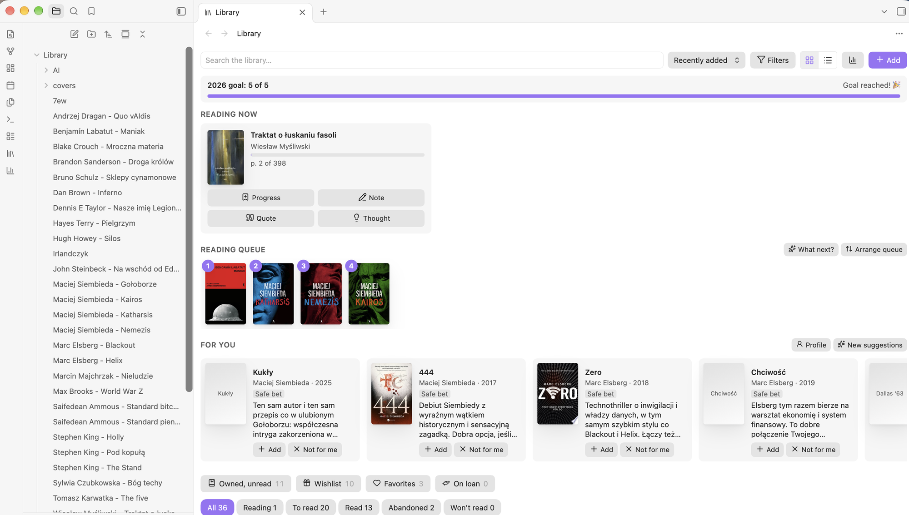
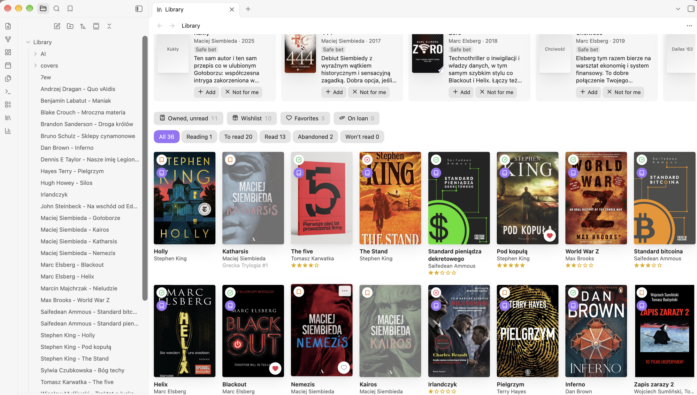
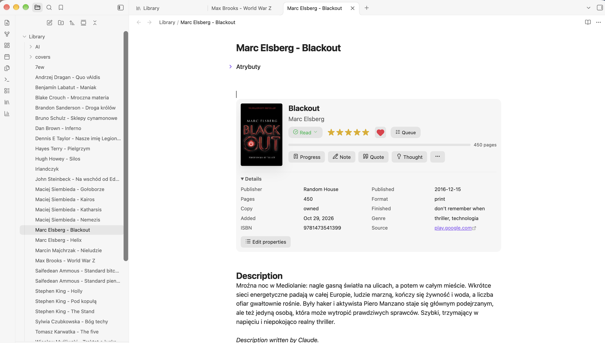
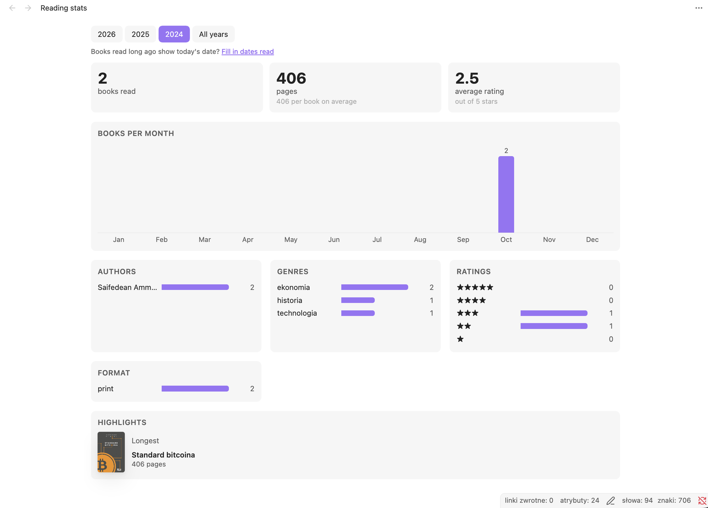
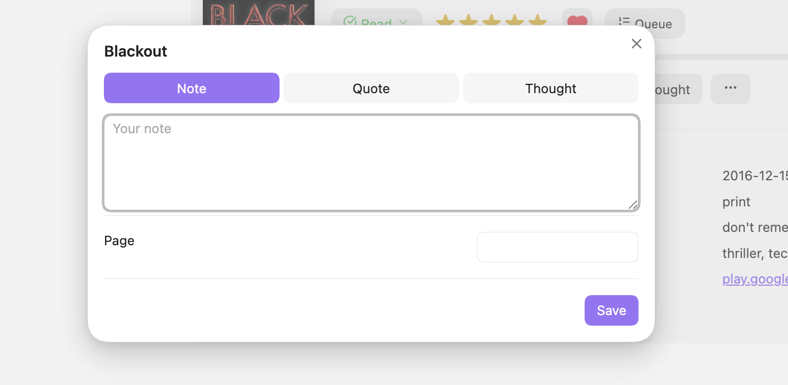

# Shelfmark

A personal library for [Obsidian](https://obsidian.md). Every book is a plain Markdown note with its data in properties, and covers are saved in the vault, so the library syncs with the rest of your notes and works offline on desktop and mobile.



## Features

- **Add books** by title, author or ISBN from Open Library, Google Books (with an API key) and, optionally, the National Library of Poland. Covers are downloaded into the vault; you can also use your own photo or paste an image.
- **Library view** with covers or a list, status tabs, search, sorting, filters (copy, format, rating, author, series, genre, year read, language) and ready-made shelves: owned but unread, wishlist, favorites, on loan.
- **Book panel** at the top of each book note: cover, status, rating, favorite, reading queue, progress, series volumes and details, with quick buttons for notes, quotes and thoughts.
- **Reading queue**, **yearly goal**, **reading progress** and **approximate read dates** ("2015", "June 2015") for books read long ago.
- **Loans** in both directions, with reminders when a book is overdue or has been away for a long time.
- **Wishlist** with priority, price, shop link and gift ideas, exportable to a note you can share or print.
- **Reading stats** per year or for all time: books and pages per month, authors, genres, ratings, formats and highlights.

### Screenshots

| | |
| --- | --- |
|  |  |
| Library grid with shelves and status tabs | Book panel in a book note |
|  |  |
| Reading stats | Quick note, quote or thought |

### Optional: Claude Code

If [Claude Code](https://claude.com/claude-code) is installed on your computer, Shelfmark can use it on your own subscription (no API key):

- book suggestions and a reading profile based on your ratings, statuses and notes,
- "What should I read next?" from the books you already own or have queued,
- a recap of previous volumes before you start the next book in a series,
- tidying up genres, unifying author names and filling in missing descriptions; every change is shown for approval first.

Claude Code runs only in Obsidian on desktop. The plugin starts the local `claude` program with no tools and no saved session, sending a summary of your library in the prompt. Results are saved as notes in the vault, so your phone can see them too. Claude writes in your preferred language (see settings).

All AI features are optional and can be turned off in settings (**AI suggestions → Show suggestions**). Shelfmark does not include Claude Code, does not log in to any Anthropic account and never handles your credentials: it only runs the `claude` program you installed yourself, which uses whatever authentication you set up in it. You are responsible for using Claude Code in line with [Anthropic's terms](https://www.anthropic.com/legal) and the "Legal and compliance" page of the Claude Code documentation; if in doubt, configure Claude Code with an Anthropic API key.

## Installation

Until Shelfmark is in the community plugin directory, install it with [BRAT](https://github.com/TfTHacker/obsidian42-brat) or manually: download `main.js`, `manifest.json` and `styles.css` from the latest release into `<vault>/.obsidian/plugins/shelfmark/`, then enable the plugin in **Settings → Community plugins**.

## Data sources

- **Open Library** works without a key.
- **Google Books** usually rejects requests without a key (shared limit). Get a free key in the Google Cloud Console: enable the "Books API", then **Credentials → API key**, and paste it in the plugin settings.
- **National Library of Poland** (data.bn.org.pl) adds Polish editions with publisher, translator and original title. Off by default.

## Network use and privacy

Shelfmark has no telemetry, no ads and no account of its own. It does not send anything anywhere on its own initiative. It connects to these services only when you use the matching feature:

| Service | When | What is sent | Why |
| --- | --- | --- | --- |
| [Open Library](https://openlibrary.org) (openlibrary.org, covers.openlibrary.org) | Searching, adding or refreshing a book, verifying AI suggestions | The search query (title, author or ISBN) | Book data, descriptions and covers |
| [Google Books API](https://developers.google.com/books) (googleapis.com, books.google.com) | The same, only if you entered an API key | The search query and your API key | Book data and covers |
| [National Library of Poland](https://data.bn.org.pl) (data.bn.org.pl) | The same, only if enabled in settings | The search query | Polish edition data |
| Any image URL you paste | Changing a cover from a pasted URL | A request for that image | Downloading the cover |
| Google Shopping | Clicking **Compare prices** on a wishlist book | Opens a search for the ISBN or title in your browser | Price comparison |
| Anthropic, through your local Claude Code | Using an AI feature (desktop only) | A summary of your library: titles, authors, statuses, ratings, dates, series, genres, wishlist priorities, book descriptions, excerpts of your own notes, quotes and thoughts, and your reading profile | Suggestions, picks, recaps and data cleanups |

Everything else stays in your vault: book notes, covers, loans (including the names of people you lend books to) and AI results are ordinary files there. Your Google Books API key is stored in the plugin's `data.json` inside your vault.

Covers and descriptions belong to their publishers and authors. Shelfmark downloads them at your request for your personal library; please respect the terms of each source.

Shelfmark is an independent project and is not affiliated with or endorsed by Anthropic, Google, the Internet Archive (Open Library), the National Library of Poland or Obsidian.

## Note properties

`type: book`, `title`, `author`, `status` (`reading` / `to read` / `read` / `abandoned` / `never`),
`rating` (1–5), `favorite`, `owned`, `format` (`print` / `ebook` / `audiobook`), `current_page`, `pages`,
`started`, `finished`, `added`, `series`, `series_index`, `queue`, `wish_priority` (`must` / `want` / `someday`),
`price`, `shop_url`, `gift`, `lent_to`, `lent_on`, `borrowed_from`, `borrowed_on`, `return_by`,
`isbn13`, `isbn10`, `publisher`, `published`, `language`, `categories`, `cover`, `avg_rating`, `ratings_count`, `source`.

A book note has the sections **Description**, **Notes**, **Quotes** and **Thoughts**, and a `shelfmark` code block where the panel is shown.

## Development

```bash
npm install
npm run dev                                       # rebuild on change
OBSIDIAN_VAULT=/path/to/vault npm run deploy      # build and copy into a vault
```

After deploying a new version, disable and re-enable the plugin in Obsidian (or reload the app).

## License

[MIT](LICENSE)
